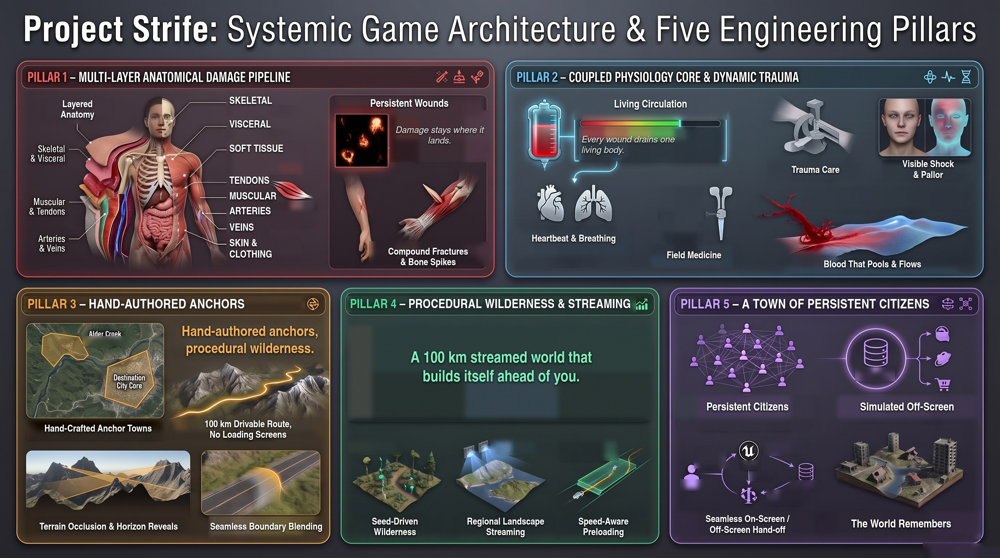

# Strife — devlog

A UE5 sandbox where buildings fail along real load paths and injuries run on a
medical simulation instead of HP bars. This is the public devlog: progress, previews
and what's coming. The game's source is private.

## What Strife is about

- **Bodies that take damage like bodies.** Layered anatomy instead of a health bar:
  wounds stay where they land, and a living circulation decides what happens next.
- **A world that keeps going.** A long, streamed route from a hand-built starting town
  to a distant city, with citizens who keep living their lives off-screen.

## Devlog

| Date | Entry |
|---|---|
| 2026-10-22 | [Systems preview](devlog/2026-10-22-systems-preview.md) |

## Gallery

| | |
|---|---|
|  |  |
|  |  |
|  |  |

All rights reserved.
